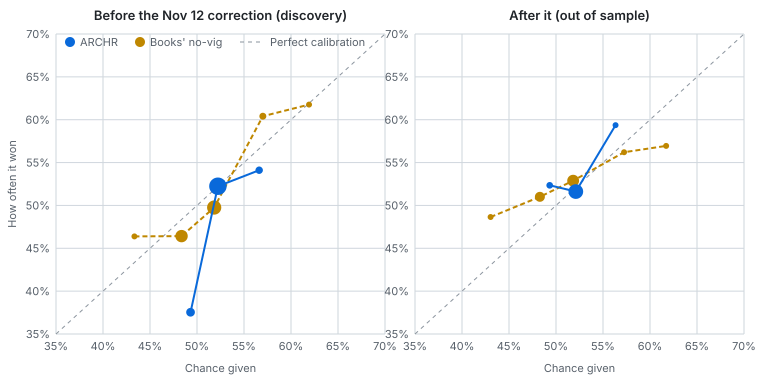

# ARCHR Edge: historical performance audit

This is measurement only. Nothing in pricing, gating, scoring or capture changed.

**Source.** Model lab run #101 (`audit:performance`), production database, 2026-11-17. Every settled pick that pick tracking froze **before its game**, graded after it. Every segment, with every metric, is in [`performance-audit-segments.md`](performance-audit-segments.md). The calibration chart is [`performance-audit-calibration.svg`](performance-audit-calibration.svg).

## Bottom line

1. **ARCHR's NBA prop picks track the market. They do not beat it.**
   - Out of sample, ARCHR's chances are as accurate as the books' own no-vig chance: Brier 0.2493 vs 0.2494, skill +0.1‰ [−2.7, +2.9].
   - They win about what that chance says: 52.5% won vs 52.2% predicted.
   - Flat-stake ROI is −3.4% [−8.9%, +2.0%], roughly the price of DraftKings' vig.
2. **Unders do not genuinely outperform overs.**
   - The unders advantage was real in the discovery period (Nov 6–12), but those are the picks the Nov 12 side correction and the screener sweep were fitted on.
   - On picks made after the correction it disappears: unders 52.6% won, −4.6% ROI; overs 52.4%, −2.4%.
   - Adjusted for odds and ARCHR's confidence, the under effect is +0.001 [−0.152, +0.219] in logit.
3. **The screener sets recommended on Nov 13 failed out of sample.**
   - "Most accurate" (L5 80%+ · unders · −200…+100 · minutes 24+) went from 60.8% won / +8.7% on its own sample to 49.6% / −12.0% on the games after.
   - Its 60.8% was the best of 8,775 combinations, chosen after the fact.
4. **One finding holds in both periods: picks whose projection sits close to the line lose.**
   - These are picks with |z| under 0.35: discovery −10.6% ROI, out of sample −6.2% [−10.9%, −1.2%].
   - That is about 72% of all picks (74% out of sample).
5. **High hit-rate bars (L10 80%+, L15 60–79%, season 80%+) never help.** They are negative in both periods, and a regression finds that no record window (L5, L10, L15, season) adds anything beyond ARCHR's chance or the books'.
6. **No segment shows profit supported by its interval out of sample.** The few positive intervals are about what 60 comparisons produce by chance (below).

## What was analysed

| | |
|---|---|
| Settled tracked picks | 11,471 (all sports and markets) |
| **Primary set:** NBA main-line props | 6,872 settled. Voids set aside: 249 (didn't play). Pushes: 0 (half-point lines). Duplicates: 0. Without a price: 1. **6,622 graded picks**. |
| Games and days | 80 games, 11 slate days (2026-11-06 → 11-16), about 83 picks per game |
| Out-of-sample split | **Discovery** (frozen before the Nov 12 22:29 UTC correction): 3,958 picks, 48 games. **Out of sample** (after it): 2,664 picks, 32 games. |
| NBA alt-line props | 2,471 graded (one-sided, so there's no no-vig market to compare) |
| NFL props | 1,639 graded, **none with a price** |
| NBA game lines | 240 graded. NFL game lines: 80 graded. |

### Which results count as out of sample

Every chance analysed here was recorded before its game, so each is out of sample for the model that made it. Two things were then fitted on these same picks:
- the NBA side correction (`NBA_MAIN_FIT`, fitted on 3,686 picks, live 2026-11-12 22:29 UTC);
- the screener sweep (`docs/filter-sweep.md`, games through Nov 12).

So the unders finding, the correction and the sweep's sets are **in sample on the discovery period**. **Only picks frozen after the correction test them.** Each pick's capture time is stored, so the split is exact. Tables show both periods; conclusions rest on the out-of-sample one.

### Backtests are kept separate

The closing-price backtests rebuild predictions from stored quotes. Only one NBA slate (Oct 27, 700 sides) and one NFL slate (Nov 1, 502 sides) of quotes are still stored. Those are too few to rank anything, so they are left out of every table here (see `docs/filter-sweep.md`).

### Frozen before the game vs rebuilt

**Frozen at capture:**
- side, line, ARCHR's shown chance (and its pre-correction raw chance);
- the price and its book, and the books' no-vig chance;
- projected minutes and z;
- the Confidence grade (since Nov 12; 39% of picks);
- screener records (since Nov 17; none settled yet).

**Rebuilt here:** L5, L10, L15 and season hit rates, games of history, starter share, and the cautious edge (which reads the L10 record).
- These use box scores from **earlier games only**, nothing from the night of the pick or later.
- They are counted the way the screener counts them.
- They are not the frozen value, so a box-score correction made after the game could shift one slightly. Tables mark these cuts "rebuilt".

### Pushes, voids, duplicates, correlation

- **Voids** (249 DNPs) are set aside, as books void them.
- **Pushes:** there were none.
- **Duplicates:** one pick per player × stat × game (none were found).
- **Correlation:** a player's points, rebounds and PRA on one night move together, as do teammates' props, and there are about 83 picks per game. So **every interval is a cluster bootstrap that resamples whole games** (400 draws, seeded). Intervals that treat picks as independent would be roughly 2–3× too narrow.

## 1. Over vs under

| | Bets | Win % [95%] | ARCHR | ROI [95%] | Avg odds | Brier ARCHR / books | Won − no-vig (pts) [95%] | CLV pts (closes ↑ / ↓) |
|---|---|---|---|---|---|---|---|---|
| **Out of sample** · over | 1,437 | 52.4% [49, 56] | 51.4% | −2.4% [−9, +5] | −115 | 0.2494 / 0.2504 | +1.8 [−1.7, +5.7] | −0.2 (41% / 47%) |
| **Out of sample** · under | 1,227 | 52.6% [47, 58] | 53.3% | −4.6% [−14, +5] | −121 | 0.2491 / 0.2482 | +0.9 [−4.4, +6.4] | +0.2 (47% / 39%) |
| Discovery · over | 2,331 | 46.4% [43, 50] | 51.5% | −14.2% [−21, −8] | −116 | 0.2496 / 0.2482 | −4.2 [−7.5, −1.0] | −0.3 (31% / 41%) |
| Discovery · under | 1,627 | 54.9% [51, 59] | 53.6% | −0.5% [−8, +7] | −122 | 0.2488 / 0.2474 | +3.2 [−0.7, +7.2] | +0.2 (39% / 30%) |

**Adjusted for odds, sample and model confidence.** Two tests, both with game-cluster bootstrap intervals:

- **Logistic regression:** won ~ offset(logit books' no-vig) + b·under + c·(logit ARCHR − logit books). Here b is the under effect beyond the price and beyond ARCHR's disagreement with it.
- **Stratified comparison:** under − over within cells of odds × ARCHR chance, where both sides have 20+ picks.

| Period | b (logit) [95%] | Stratified under − over ROI | Stratified under − over, won − no-vig |
|---|---|---|---|
| Discovery (in sample) | +0.128 [−0.059, +0.289] | +8.6% | +4.7 pts |
| **Out of sample** | **+0.001 [−0.152, +0.219]** | **−0.8%** | **−0.2 pts** |
| All | +0.072 [−0.062, +0.199] | +4.6% | +2.5 pts |

**Verdict: no.**
- During discovery, unders did beat overs (by about 8 ROI points stratified). That gap is why the correction tilts toward unders.
- After the correction there is no difference, and no period's interval excludes zero.
- What the correction fixed was overs running hot: overs went from 5.1 pts below ARCHR's chance to 1.0 pt above. It did not create an under edge.
- Unders also carry worse average odds (−121 vs −115), so a raw win-rate edge on unders overstates what they pay.

## 2. Prop market (out of sample, then discovery)

| Market | Bets | Win % | ROI [95%] | Won − no-vig [95%] | Discovery ROI |
|---|---|---|---|---|---|
| points | 394 | 56.1% | +5.2% [−4, +13] | **+5.9 [+1.1, +10.2]** | −12.4% |
| threes | 325 | 54.8% | −2.4% [−9, +4] | +1.4 [−2.2, +5.0] | −1.9% |
| pts + ast | 302 | 53.3% | −0.3% [−10, +10] | +3.2 [−2.0, +8.9] | −12.6% |
| pts + reb | 374 | 52.4% | −2.4% [−11, +6] | +2.1 [−2.6, +6.8] | −8.7% |
| rebounds | 368 | 52.4% | −3.8% [−15, +6] | +1.0 [−4.9, +6.3] | −4.6% |
| assists | 294 | 50.7% | −9.1% [−21, +2] | −1.8 [−8.2, +4.3] | −7.9% |
| PRA | 303 | 49.8% | −7.0% [−16, +3] | −0.3 [−5.0, +5.0] | −11.6% |
| reb + ast | 304 | 49.0% | −10.4% [−22, +0] | −2.0 [−7.9, +3.7] | −8.9% |

- **Points** is the only market whose won − no-vig interval clears zero out of sample. But it was the second-worst market in discovery, and it's one of roughly 60 comparisons. Treat it as a watch item, not an edge.
- **reb + ast, assists and PRA** are negative in both periods.
- **threes** is closest to break-even in both.

## 3. ARCHR probability ranges

| ARCHR chance | Out of sample: bets, won, ROI | Discovery: bets, won, ROI |
|---|---|---|
| 40–49% | 405 · 52.3% · +0.2% | 682 · **37.5% · −28.7%** |
| 50–54% | 1,947 · 51.6% · −5.3% | 2,747 · 52.2% · −4.2% |
| 55–59% | 283 · 59.4% · +6.1% [−10, +21] | 499 · 54.1% · −4.2% |
| 60–64% | 29 · 44.8% · ⚠ too few | 29 · 44.8% · ⚠ too few |
| 65–69% | — | 1 · ⚠ |
| 70%+ | none | none |

**Where picks sit.** ARCHR almost never says more than 60% on a main line: 99% of picks sit between 45% and 60%. That isn't surprising: the side correction keeps only 5% of ARCHR's disagreement with the books (k = 0.05).

**The 40–49% bucket** holds overs where ARCHR's projection points over but its corrected chance is under 50%. During discovery it was a disaster: 37.5% won. Out of sample it's break-even (52.3%). Those discovery picks are the very ones the correction was fitted on, so this isn't a stable signal either way.

**The 55–59% bucket** is the one that improves with confidence (59.4% won out of sample). Its interval spans zero, and only 283 picks fall in it.

## 4. Odds ranges

| Price | Out of sample: bets, won, ROI [95%] | Discovery: bets, won, ROI |
|---|---|---|
| −200 or shorter | 26 ⚠ · 57.7% · −16.3% | 50 · 60.0% · −12.6% |
| −199 to −101 | 2,380 · 53.2% · −3.4% [−9, +2] | 3,541 · 50.9% · −7.7% |
| +100 to +124 | 216 · 45.4% · −5.3% [−20, +10] | 316 · 38.6% · −19.3% |
| +125 to +149 | 40 ⚠ · 45.0% · +5.4% | 41 · 41.5% · −2.0% |
| +150 to +199 | 2 ⚠ | 10 ⚠ |
| +200+ | none | none |

- 89% of picks are priced −199 to −101.
- Plus-money main lines (+100 to +124) were the worst range in discovery and are still negative out of sample.
- Nothing above +150 has a sample.

## 5. Cautious edge (rebuilt)

| Cautious edge | Out of sample: bets, won, ROI | Discovery: bets, won, ROI |
|---|---|---|
| negative | 2,549 · 52.5% · −3.6% | 3,696 · 50.4% · −8.0% |
| 0–5% | 80 ⚠ · 52.5% · +2.0% | 177 · 44.1% · −15.5% |
| 5–10% | 25 ⚠ · 52.0% · +5.8% | 63 ⚠ · 41.3% · −19.3% |
| 10–20% | 8 ⚠ | 20 ⚠ |
| 20%+ | 2 ⚠ | 2 ⚠ |

- 94% of picks have a negative cautious edge. The cautious read discounts ARCHR's chance toward the record, and the price's implied chance includes vig, so few picks clear it.
- Positive cautious edge did **worse** in discovery (−15.5%, −19.3%), and out of sample it's too small to read.
- The cautious edge does not identify better picks in this data.

## 6. Do historical hit rates improve accuracy?

**By bucket** (out of sample · discovery ROI):

| Window | Under 40% | 40–59% | 60–79% | 80%+ |
|---|---|---|---|---|
| L5 | +3.6% · −2.3% | −2.4% · −10.6% | −6.9% · −8.6% | −3.8% · −9.5% |
| L10 | +6.0% · −12.1% | −1.8% · −6.7% | −6.0% · −8.7% | **−14.2% · −12.4%** |
| L15 | −3.8% · −14.8% | +1.3% · −6.9% | **−9.2% [−17.7, −0.6]** · −8.3% | −7.2% · −11.9% |
| Season | −1.0% · −11.7% | −0.8% · −5.8% | −8.4% · −8.6% | **−13.6% · −12.9%** |

**Regression: does the window add information?**
- The test fits won ~ offset(logit chance) + b·(hit rate − 50%), with game-cluster bootstrap intervals and 5+ games in the window.
- A positive b whose interval clears zero would mean the window knows something the chance doesn't.

| Window | Beyond ARCHR, all [95%] | Beyond the books, all [95%] | Beyond ARCHR, out of sample [95%] |
|---|---|---|---|
| L5 | −0.158 [−0.490, +0.173] | −0.175 [−0.502, +0.159] | −0.146 [−0.726, +0.502] |
| L10 | −0.238 [−0.780, +0.298] | −0.287 [−0.819, +0.276] | −0.367 [−1.122, +0.634] |
| L15 | −0.350 [−0.905, +0.274] | −0.336 [−0.905, +0.251] | −0.560 [−1.277, +0.244] |
| Season | −0.151 [−0.718, +0.501] | −0.225 [−0.755, +0.394] | −0.278 [−1.095, +0.874] |

**Verdict: no.** Every coefficient is negative, and none is distinguishable from zero. A hot record at the line is already in the price.
- Bars of 80%+ (L10, season) are the worst-performing record buckets in both periods. Pricier lines and regression toward the mean probably explain it.
- **Don't use hit-rate bars as positive filters.**

## 7. Minutes, role, history, sportsbook

| Cut | Out of sample: bets, won, ROI [95%] | Discovery: bets, won, ROI |
|---|---|---|
| **Projected minutes** under 20 | 133 ⚠ · 63.2% · +16.9% [−8, +41] | 184 · 42.4% · −24.1% |
| 20–27 | 1,069 · 52.3% · −3.8% | 1,503 · 47.2% · −13.2% |
| 28–33 | 1,165 · 50.5% · −7.5% [−15, −1] | 1,691 · 53.1% · −3.0% |
| 34+ | 297 · 56.2% · +5.0% | 580 · 49.8% · −8.1% |
| **Role** starter (7+ of last 10) | 1,920 · 51.7% · −4.9% | 2,834 · 51.8% · −5.2% |
| bench (3 or fewer) | 574 · 53.3% · −1.7% | 771 · 47.6% · −12.5% |
| mixed | 170 ⚠ · 58.2% · +7.4% | 353 · 39.7% · −27.5% |
| **History** under 20 games | 232 · 53.4% · −1.2% | 333 · 50.5% · −7.6% |
| 20–49 | 196 ⚠ · 44.9% · −17.7% | 364 · 54.9% · +0.6% |
| 50–99 | 2,039 · 53.2% · −2.0% | 3,033 · 48.7% · −10.8% |
| 100+ | 197 ⚠ · 51.8% · −6.0% | 228 · 57.0% · +5.0% |

**Every one of these flips sign between periods.** None is stable enough to filter on.

**Sportsbook can't be analysed.** Every price is DraftKings'. The free ESPN feed is the only priced prop source, so there's no line shopping and no book comparison. The cut shows "DraftKings" and "Draft Kings", which are the same book spelled two ways.

## Calibration and reliability

**ARCHR**, said vs won by bucket (buckets of 30+ picks):

| Bucket | Discovery: bets, said → won | Out of sample: bets, said → won |
|---|---|---|
| 45–50% | 682 · 49.3% → **37.5%** | 405 · 49.3% → 52.3% |
| 50–55% | 2,747 · 52.2% → 52.2% | 1,947 · 52.1% → 51.6% |
| 55–60% | 499 · 56.6% → 54.1% | 283 · 56.3% → 59.4% |

**The books' no-vig chance, out of sample:**
- 45–50%: 896 · 48.3% → 51.0%
- 50–55%: 1,265 · 51.8% → 52.9%
- 55–60%: 290 · 57.2% → 56.2%

**Reading the chart:**
- After the correction, ARCHR is well calibrated where it has a sample. The overall gap is +0.2 pts, and the discovery period's −11.8-pt hole at 45–50% is gone.
- ARCHR is calibrated about as well as the books. Its Brier is the same (0.2493 vs 0.2494) and its log loss is the same (0.692 vs 0.692).
- ARCHR compresses its chances near 50%: 99% of picks sit at 45–60%. So it rarely says anything far from the market.

## Closing-line value

**Coverage:** NBA main-line props have a closing line on 100% of picks.

| Period | Average move toward the pick | Closes toward / away |
|---|---|---|
| Out of sample | 0.0 pts | 44% / 43% |
| Discovery | −0.1 pts | 34% / 36% |

- The rest of the closes didn't move.
- No segment shows positive CLV with a meaningful sample, so the market doesn't move toward ARCHR's picks. That fits the skill result: ARCHR's chance is close to the market's, so there is little for the market to correct.
- CLV here is measured against DraftKings' own line move, from the hours before tip to the close.

## Ranking: strongest and weakest segments

These rankings use out-of-sample picks only, segments with 200+ picks, and judge each segment by its interval, never by raw win rate. About 60 out-of-sample segments were compared, so 2–3 intervals clearing zero by chance alone is expected.

**Strongest** (none has an ROI interval above zero):

| # | Segment | Bets | ROI [95%] | Won − no-vig [95%] | Skill ‰ [95%] | Same direction in discovery? |
|---|---|---|---|---|---|---|
| 1 | Projection distance \|z\| 0.35–0.75 | 601 | +6.9% [−6, +20] | +6.9 [−0.5, +13.7] | **+4.9 [+0.4, +9.2]** | yes (+0.9 pts, −4.8% ROI) |
| 2 | ARCHR 55–59% | 283 | +6.1% [−10, +21] | +6.7 [−2.2, +15.0] | — | yes (+1.3 pts) |
| 3 | Points | 394 | +5.2% [−4, +13] | **+5.9 [+1.1, +10.2]** | +0.7 | **no** (−3.5 pts, −12.4%) |
| 4 | L15 40–59% | 1,303 | +1.3% [−6, +8] | **+4.1 [+0.1, +7.5]** | −0.7 | no (−0.2 pts) |

**Weakest** (consistently negative in both periods):

| # | Segment | Out-of-sample ROI [95%] | Discovery ROI |
|---|---|---|---|
| 1 | **Projection near the line (\|z\| < 0.35)**, 72% of picks | **−6.2% [−10.9, −1.2]** (1,968) | −10.6% [−15.2, −6.0] (2,826) |
| 2 | L10 80%+ | −14.2% [−29, +1] (195) | −12.4% (349) |
| 3 | Season 80%+ | −13.6% [−33, +6] (124 ⚠) | −12.9% (230) |
| 4 | L15 60–79% | **−9.2% [−17.7, −0.6]** (949) | −8.3% (1,567) |
| 5 | Reb + ast | −10.4% [−22, +0] (304) | −8.9% (450) |
| 6 | Assists | −9.1% [−21, +2] (294) | −7.9% (414) |
| 7 | PRA | −7.0% [−16, +3] (303) | −11.6% (454) |

**Other tracked picks:**
- **NBA alt-line props** are the weakest market tracked: 2,471 picks, 30.3% won vs 37.4% said, −13.6% ROI [−21, −7] at an average of +199. That's a 7-pt overstatement, even after the alt correction.
- **NFL game lines:** 80 picks, 32.5% won, −35.8% [−55, −13] ⚠ small.
- **NBA game lines:** 240 picks, −0.8% [−15, +15].

## Screening filters the evidence supports

**Things to stop doing:**
1. **Retire the "Most accurate" and "Unders base" recommendations.** They lost out of sample:

   | Set | Out-of-sample bets | Win % | ROI | Won − no-vig |
   |---|---|---|---|---|
   | Most accurate | 242 | 49.6% | −12.0% | −2.9 |
   | Unders base | 917 | 52.7% | −4.6% | +0.9 |

   Keep them tracked forward (#131 tags them) so they can earn their way back. Adding "ARCHR 50%+" to either changes nothing (the same picks).
2. **Don't filter on unders** for its own sake (section 1).
3. **Don't use hit-rate bars** (L5/L10/L15/season ≥ 60–80%) as positive filters (section 6). If anything, 80%+ marks overpriced lines.
4. **Avoid alt lines** for straight bets: −13.6%, overstated by 7 pts.

**What to do:**

5. **Avoid picks whose projection sits close to the line (|z| < 0.35).** This is the only result that holds in both periods and clears zero out of sample.
   - The screener can't set it yet. Adding a "distance from line" filter is the one change the evidence supports.
   - The 0.35–0.75 band is the only segment where ARCHR beats the books with an interval clear of zero (skill +4.9‰ [+0.4, +9.2]). It's still unproven on profit (+6.9% [−6, +20]).
6. **Treat everything else as a coin flip at the vig until more weeks settle.** Out of sample covers only 5 slate days and 32 games. Re-run `audit:performance` weekly: the out-of-sample set grows by about 80 games a week.

## Data that's missing (what is not stored)

| Missing | Effect |
|---|---|
| **NFL prop prices.** All 1,699 NFL prop picks were frozen from ESPN numbers with no price. | No ROI, odds or no-vig market for NFL props, and no NFL prop profitability can be measured. |
| **Any book but DraftKings** | No sportsbook comparison and no line shopping. "Best price" means DraftKings' price. |
| **Closing lines for NBA moneylines and totals** (0%), and NBA alt props (11%) | No CLV for those markets. |
| **Frozen hit-rate records before Nov 17** | Section 5–6 cuts use records rebuilt from earlier box scores. Records frozen since Nov 17 haven't settled yet. |
| **Frozen role and history counts** | Role is starts in the last 10 and history is games before the pick, both rebuilt. There's no frozen expected-starter flag. |
| **Confidence grade before Nov 12** | The grade is on 39% of picks, mostly grade D (2,355) and C (208). B has 2 picks; A has none. The grade can't be judged yet. |
| **Your actual bets** | Everything here is ARCHR's tracked lean at flat stakes, not the bets you placed. |
| **History before Nov 6** | Tracking started then. 11 slate days total; 5 out of sample. |
| **Backtest quotes** | Only one NBA slate and one NFL slate of closing quotes are still stored, so the backtest can't be used to rank segments. |

## Selection effects to keep in mind

- **The picks are ARCHR's lean side, not a random sample of props.** Each pick is the side ARCHR's projection points to (the NBA standout read). Over/under results describe ARCHR's choices, not overs and unders in general.
- **One price source.** Every price is DraftKings' at capture, a few hours before tip. Another book or a later price would give different ROI.
- **A short, possibly unrepresentative window.** All 80 games fall in early-season November.
- **Many comparisons.** About 60 out-of-sample segments were compared, so a few "significant" intervals are expected by chance. Only results that agree across both periods should be trusted.

## Reproduce

Model lab → `audit:performance` (read-only):
- `scripts/audit-performance.ts`: the script;
- `src/lib/audit/performance.ts`: pure and tested; covers metrics, cluster bootstrap, calibration and the offset logistic regression.

Each segment and the calibration bins are printed as `@@SEG@@` / `@@CALIB@@` JSON lines, which is where these tables come from.
